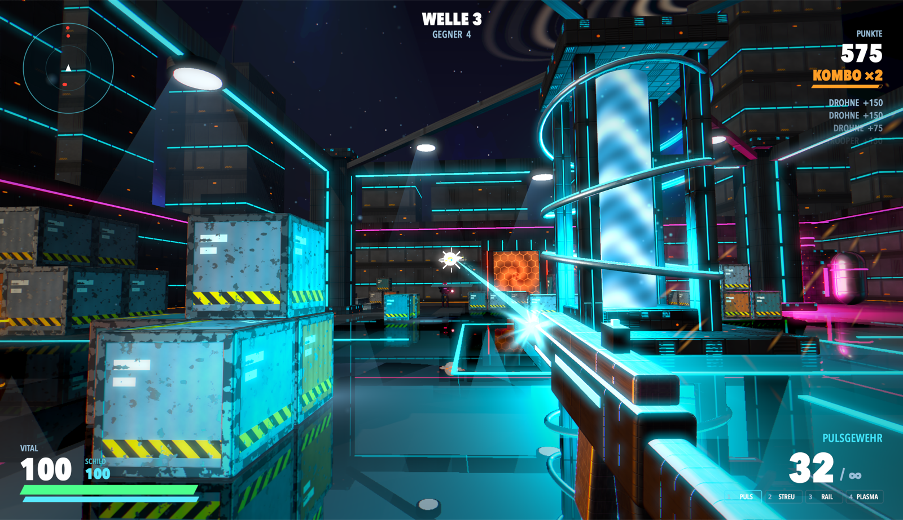
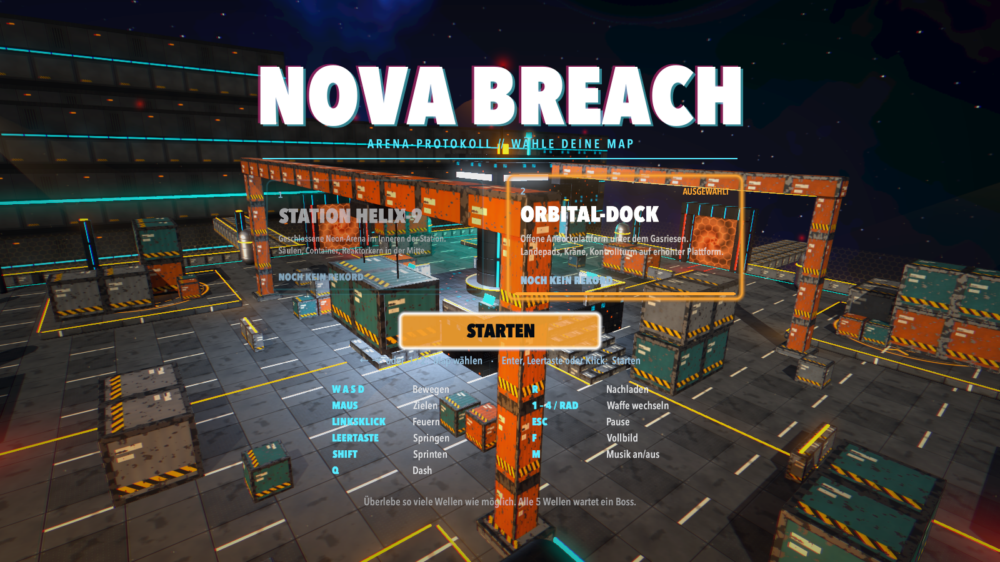
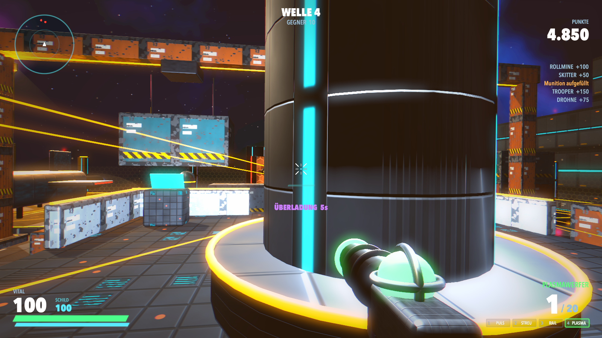
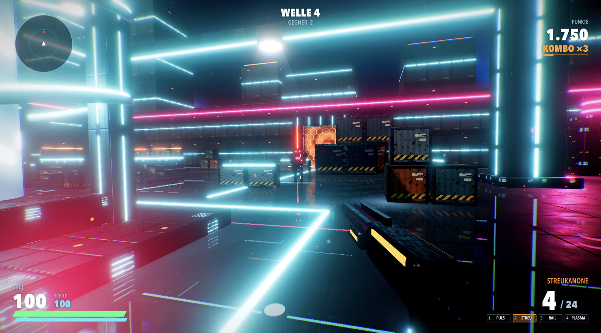

# NOVA BREACH

PvE-Arena-Shooter in 3D für Apple Silicon. Native Swift-App auf Apples SceneKit/Metal-Renderer,
alles (Texturen, Modelle, Skybox, Sounds, Musik) wird beim Start prozedural erzeugt – keine Asset-Dateien.



## Spielen

`dist/NovaBreach.dmg` öffnen, **NOVA BREACH** nach *Programme* ziehen, starten.

| Taste | Aktion |
|---|---|
| W A S D | Bewegen |
| Maus | Zielen |
| Linksklick | Feuern |
| Leertaste | Springen |
| Shift | Sprinten |
| Q | Dash (kurz unverwundbar) |
| E | Fähigkeit (im Labor gewählt, nur Mac-Version) |
| R | Nachladen |
| 1–4 / Mausrad | Waffe wechseln |
| ESC | Pause |
| Q (in Pause / Game Over) | Zurück zum Hauptmenü |
| L (im Hauptmenü) | Labor öffnen/schließen (nur Mac-Version) |
| 1–3 / Klick (nach einer Welle) | Upgrade wählen (nur Mac-Version) |
| F | Vollbild an/aus |
| M | Musik an/aus |
| ⌘Q | Beenden |

Wellen-Survival: Gegner kommen durch die vier roten Portale, alle 5 Wellen ein Boss (Overseer). In Welle 15 wartet stattdessen der Endgegner: ein 8,5 m großer Hitler, der stampft (Schockwelle – springen!), Raketen aus den Händen und Laser aus den Augen schießt und Verstärkung ruft. Schwachpunkt ist der Kopf (nur Mac-Version).



Im Hauptmenü wählst du die Map (Pfeiltasten ← →, Tasten 1/2 oder Klick auf eine Karte, dann STARTEN oder Enter). Jede Map hat ihren eigenen Rekord.

| Map | Beschreibung |
|---|---|
| Station Helix-9 | Geschlossene Neon-Arena im Inneren der Station: Säulen, Container, Reaktorkern in der Mitte |
| Orbital-Dock | Offene Andockplattform unter dem Gasriesen: erhöhte Plattform mit Kontrollturm, vier Landepads, Portalkräne mit hängenden Containern, Kraftfeld als Rand (nur Mac-Version) |


Schild lädt sich nach 4 Sekunden ohne Treffer wieder auf, Vital nur über grüne Pickups.
Kopf-/Kerntreffer machen doppelten Schaden. Rollminen explodieren und reißen andere Gegner mit.

## Fortschritt (nur Mac-Version)

**Upgrades nach jeder Welle.** Nach jeder geschafften Welle friert das Spiel ein und du wählst eins von drei zufälligen Upgrades (Tasten 1–3 oder Klick). Upgrades gelten bis zum Systemausfall, jeder Run baut sich anders.

| Art | Beispiele |
|---|---|
| Werte | Feuerkraft (+12 % Schaden), Erweiterte Magazine, Schnelllader, Panzerplatten (+25 max. Vital), Schildmatrix, Servomotoren, Dash-Spulen, Munitionsgurt – meist mehrstufig |
| Waffen-Mods | Puls: Querschläger · Streu: Brandmunition · Rail: Entladung (Explosion am Einschlag) · Plasma: Schwerkern (+50 % Radius, kein Eigenschaden) |
| Fähigkeit | Schnellladung (−25 % Abklingzeit), Verstärkung (stärker/länger) |

**Kerne und Labor.** Für jede Welle gibt es Kerne (1, ab Welle 5 je 2, ab Welle 10 je 3 …), für Bosse 5 (Endgegner 15) und für überstandene Wellen-Ereignisse Bonus-Kerne. Kerne bleiben dauerhaft gespeichert. Im **Labor** (Hauptmenü, Taste L oder Klick) gibst du sie aus:

| Freischaltung | Preis |
|---|---|
| Fähigkeit Geschützturm / Kraftfeld / Zeitlupe | 40 / 40 / 50 |
| Perk Übertaktung (+10 % Feuerrate) | 30 |
| Perk Notfallprotokoll (einmal pro Run wiederbeleben) | 45 |
| Mod Puls: Zwillingslauf · Streu: Abpraller · Rail: Kettenblitz · Plasma: Streubombe | 35 · 30 · 40 · 35 |

Erforschte Perks tauchen danach in der Upgrade-Wahl auf.

**Fähigkeit auf E.** Eine Fähigkeit ist ausgerüstet (im Labor wechseln):

| Fähigkeit | Wirkung | Abklingzeit |
|---|---|---|
| Splittergranate | Wurfgranate, explodiert beim Aufprall (150 Schaden) | 7 s |
| Geschützturm | Turm feuert 14 s lang selbstständig auf Gegner in Sichtweite | 24 s |
| Zeitlupe | Gegner und ihre Geschosse 5 s lang auf 30 % Tempo | 22 s |
| Kraftfeld | Kuppel für 6 s, die feindliche Geschosse auslöscht | 18 s |

**Wellen-Ereignisse.** Ab Welle 3 hat ungefähr jede zweite normale Welle ein Ereignis (nie bei Bossen, nie zweimal hintereinander). Welches kommt, siehst du schon bei der Upgrade-Wahl.

| Ereignis | Wirkung | Bonus |
|---|---|---|
| Niedrige Schwerkraft | höhere Sprünge, Geschosse fliegen weiter | +2 Kerne |
| Stromausfall | Arena-Licht aus, Helmlampe an | +3 Kerne |
| Schwarm | viel mehr Skitter, Drohnen und Rollminen | +3 Kerne |
| Adrenalin | Gegner schneller und aggressiver, doppelte Punkte | +2 Kerne |
| Kernsturm | Gegner lassen Kerne fallen | Drops |
| EMP-Sturm | Schild offline | +4 Kerne |

## Windows

`dist/windows/NovaBreach.exe` auf einen Windows-PC (10/11, 64 Bit) kopieren und starten – kein Installer, die Datei entpackt sich beim Start selbst. Alternativ `dist/windows/NovaBreach-Windows.zip` entpacken und `NOVA BREACH.exe` im Ordner starten (startet schneller).

Die Windows-Version ist ein Port nach JavaScript + three.js (WebGL 2) in einer Electron-Hülle, mit denselben Werten, Gegnern, Waffen, Sounds und Texten. Die Auflösung passt sich automatisch an, damit es auch auf Laptops mit integrierter Grafik flüssig bleibt. Die exe ist nicht signiert: Windows SmartScreen zeigt beim ersten Start „Der Computer wurde durch Windows geschützt“ → *Weitere Informationen* → *Trotzdem ausführen*.



Neu bauen (läuft auf dem Mac, braucht nur Node.js):

```bash
win/build-win.sh
```

Tests ohne Windows (gleiche Chromium-Engine wie die exe):

```bash
cd win && node build.mjs && node_modules/.bin/electron . --autotest /tmp/frame.png --wave 5 --at 20
```

`--inputtest` schickt echte Klicks/Tasten statt Autopilot, `--mortal` testet Game Over, `--query "pose=lineup"` zeigt alle Gegner.

## Bauen

Braucht nur die Xcode Command Line Tools (kein volles Xcode):

```bash
./build.sh
```

Ergebnis: `dist/NOVA BREACH.app` und `dist/NovaBreach.dmg` (arm64, ab macOS 13, ad hoc signiert).

Testmodi der Binary (ohne Eingabe, mit Autopilot):

```bash
"dist/NOVA BREACH.app/Contents/MacOS/NovaBreach" --shots /tmp/shots --seconds 60 --every 10
```

```bash
"dist/NOVA BREACH.app/Contents/MacOS/NovaBreach" --autotest /tmp/frame.png --wave 5
```

`--shots` rendert ohne Fenster, `--autotest` öffnet kurz ein echtes Fenster und speichert ein Bild.

Fortschritt testen (Testläufe speichern keine Kerne):

```bash
"dist/NOVA BREACH.app/Contents/MacOS/NovaBreach" --autotest /tmp/frame.png --wave 4 --at 25 --perks railChain,railNova,damage --ability turret --event blackout
```

`--perks` nimmt Namen aus `Sources/Perks.swift` (`PerkID`) oder `all`, `--ability` einen aus `AbilityID` (`grenade`, `turret`, `slowmo`, `barrier`), `--event` einen aus `WaveEvent` (`lowGravity`, `blackout`, `swarm`, `frenzy`, `coreRush`, `emp`) für jede normale Welle. Der Autopilot nimmt nach jeder Welle ein zufälliges Upgrade und benutzt die Fähigkeit.

## Aufbau

| Datei | Inhalt |
|---|---|
| `Sources/main.swift` | Fenster, Eingabe, Maus-Capture, Testmodi, Icon-Renderer |
| `Sources/Game.swift` | Spielzustand, Spieler, Kamera, Wellen, Autopilot |
| `Sources/Combat.swift` | Waffen, Schaden, Projektile, Pickups, Gegner-KI |
| `Sources/Perks.swift` | Perks, Fähigkeiten, Wellen-Ereignisse, dauerhafter Fortschritt (Kerne, Labor) |
| `Sources/Progression.swift` | Upgrade-Wahl, Labor, Wellen-Ereignisse, Waffen-Mods |
| `Sources/Abilities.swift` | Fähigkeit auf E: Granate, Geschützturm, Zeitlupe, Kraftfeld |
| `Sources/Enemies.swift` | Gegnertypen und ihre Modelle |
| `Sources/Maps.swift` | Map-Liste (Name, Beschreibung, Farbe, Rekord-Schlüssel) |
| `Sources/Level.swift` | Arena Helix-9, Kollision, Wegfindung (Flow-Field) |
| `Sources/LevelDock.swift` | Map Orbital-Dock |
| `Sources/Textures.swift` | prozedurale PBR-Texturen und Skybox |
| `Sources/Effects.swift` | Partikel, Tracer, Explosionen, Lichtblitze |
| `Sources/HUD.swift` | HUD und Menüs (SpriteKit-Overlay) |
| `Sources/Audio.swift` | Synthese aller Sounds und der Musik |
