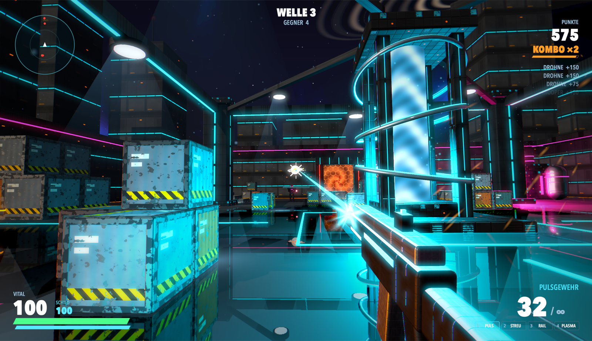
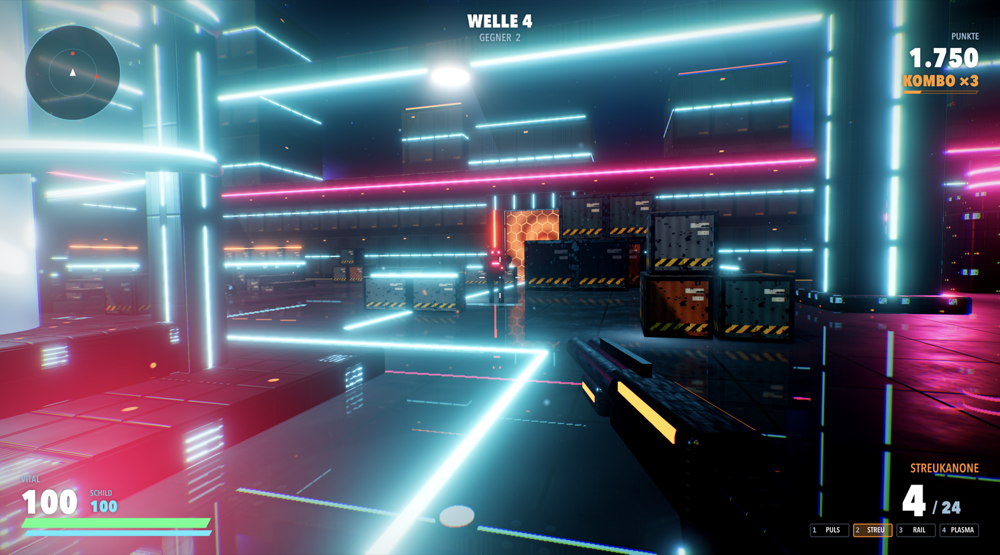

# NOVA BREACH

PvE-Arena-Shooter in 3D für Apple Silicon. Native Swift-App auf Apples SceneKit/Metal-Renderer,
alles (Texturen, Modelle, Skybox, Sounds, Musik) wird beim Start prozedural erzeugt – keine Asset-Dateien.



## Spielen

`dist/NovaBreach.dmg` öffnen, **NOVA BREACH** nach *Programme* ziehen, starten.

| Taste | Aktion |
|---|---|
| W A S D | Bewegen |
| Maus | Zielen |
| Linksklick | Feuern |
| Leertaste | Springen |
| Shift | Sprinten |
| Q | Dash (kurz unverwundbar) |
| R | Nachladen |
| 1–4 / Mausrad | Waffe wechseln |
| ESC | Pause |
| F | Vollbild an/aus |
| M | Musik an/aus |
| ⌘Q | Beenden |

Wellen-Survival: Gegner kommen durch die vier roten Portale, alle 5 Wellen ein Boss (Overseer).
Schild lädt sich nach 4 Sekunden ohne Treffer wieder auf, Vital nur über grüne Pickups.
Kopf-/Kerntreffer machen doppelten Schaden. Rollminen explodieren und reißen andere Gegner mit.

## Windows

`dist/windows/NovaBreach.exe` auf einen Windows-PC (10/11, 64 Bit) kopieren und starten – kein Installer, die Datei entpackt sich beim Start selbst. Alternativ `dist/windows/NovaBreach-Windows.zip` entpacken und `NOVA BREACH.exe` im Ordner starten (startet schneller).

Die Windows-Version ist ein Port nach JavaScript + three.js (WebGL 2) in einer Electron-Hülle, mit denselben Werten, Gegnern, Waffen, Sounds und Texten. Die Auflösung passt sich automatisch an, damit es auch auf Laptops mit integrierter Grafik flüssig bleibt. Die exe ist nicht signiert: Windows SmartScreen zeigt beim ersten Start „Der Computer wurde durch Windows geschützt“ → *Weitere Informationen* → *Trotzdem ausführen*.



Neu bauen (läuft auf dem Mac, braucht nur Node.js):

```bash
win/build-win.sh
```

Tests ohne Windows (gleiche Chromium-Engine wie die exe):

```bash
cd win && node build.mjs && node_modules/.bin/electron . --autotest /tmp/frame.png --wave 5 --at 20
```

`--inputtest` schickt echte Klicks/Tasten statt Autopilot, `--mortal` testet Game Over, `--query "pose=lineup"` zeigt alle Gegner.

## Bauen

Braucht nur die Xcode Command Line Tools (kein volles Xcode):

```bash
./build.sh
```

Ergebnis: `dist/NOVA BREACH.app` und `dist/NovaBreach.dmg` (arm64, ab macOS 13, ad hoc signiert).

Testmodi der Binary (ohne Eingabe, mit Autopilot):

```bash
"dist/NOVA BREACH.app/Contents/MacOS/NovaBreach" --shots /tmp/shots --seconds 60 --every 10
```

```bash
"dist/NOVA BREACH.app/Contents/MacOS/NovaBreach" --autotest /tmp/frame.png --wave 5
```

`--shots` rendert ohne Fenster, `--autotest` öffnet kurz ein echtes Fenster und speichert ein Bild.

## Aufbau

| Datei | Inhalt |
|---|---|
| `Sources/main.swift` | Fenster, Eingabe, Maus-Capture, Testmodi, Icon-Renderer |
| `Sources/Game.swift` | Spielzustand, Spieler, Kamera, Wellen, Autopilot |
| `Sources/Combat.swift` | Waffen, Schaden, Projektile, Pickups, Gegner-KI |
| `Sources/Enemies.swift` | Gegnertypen und ihre Modelle |
| `Sources/Level.swift` | Arena, Kollision, Wegfindung (Flow-Field) |
| `Sources/Textures.swift` | prozedurale PBR-Texturen und Skybox |
| `Sources/Effects.swift` | Partikel, Tracer, Explosionen, Lichtblitze |
| `Sources/HUD.swift` | HUD und Menüs (SpriteKit-Overlay) |
| `Sources/Audio.swift` | Synthese aller Sounds und der Musik |
